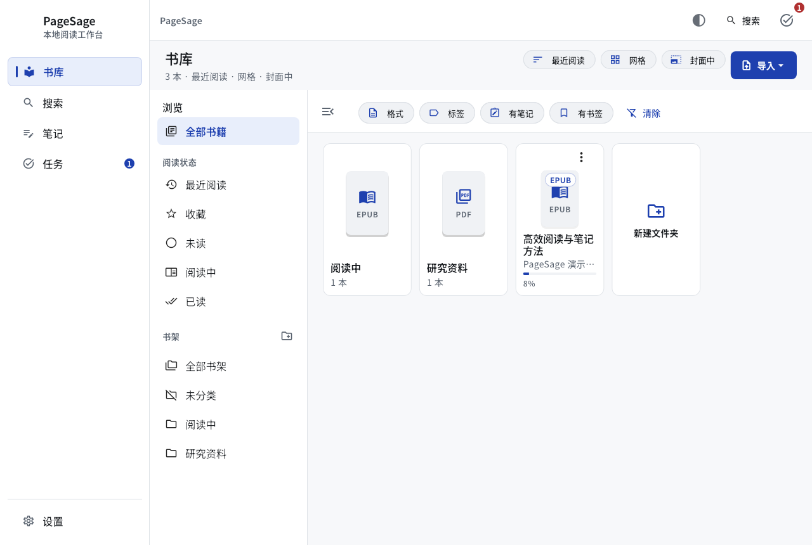
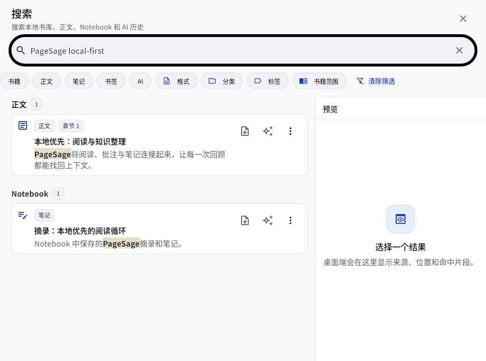
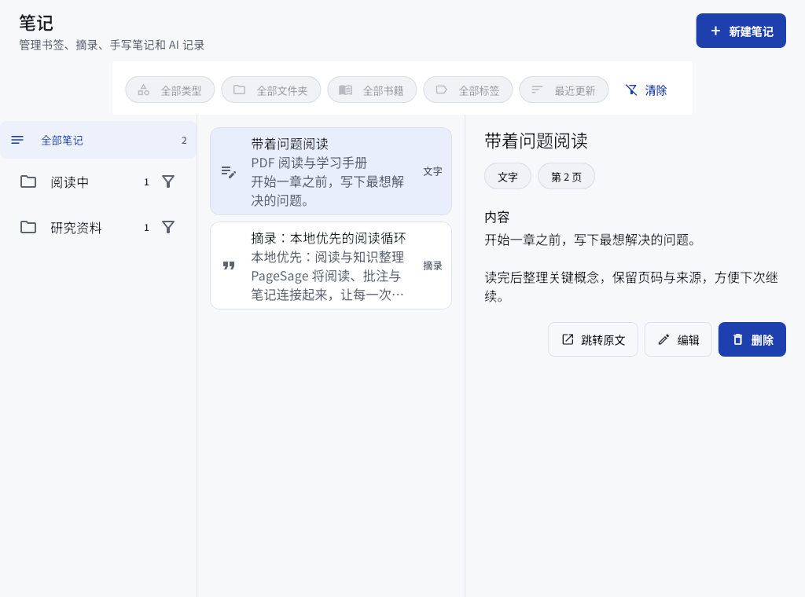

<div align="center">


# PageSage

**把阅读、批注和知识整理，留在同一个地方。**

一款本地优先的 EPUB · PDF · Markdown 阅读器，使用 Flutter 构建。

[Linux CI](https://github.com/DCAM-03/pagesage/actions/workflows/linux.yml) · [Windows / Android CI](https://github.com/DCAM-03/pagesage/actions/workflows/windows-android.yml)

[功能亮点](#功能亮点) · [界面预览](#界面预览) · [下载与安装](#下载与安装) · [开发指南](#开发指南) · [项目文档](#项目文档)

</div>

---

PageSage 把电子书、论文和 Markdown 文档放进统一书库。读到重要的地方，可以划线、写批注、保存笔记，也可以结合原文向 AI 提问；需要回看时，从搜索结果、笔记或来源引用返回阅读位置。

**当前处于早期测试阶段。** Linux 已有 beta 候选与构建、安装验证；Windows / Android 已接入构建和部分自动验证，仍需继续做实际设备验收。各平台的构建状态见上方 CI 链接，具体能力与验证边界见[实现记录](docs/implementation-status.md)。

## 界面预览

以下图片由当前代码的真实界面组件离屏生成，使用受控演示数据，不包含个人书库、API key 或私人正文。它们用于展示界面布局，不代表 Windows / Android 真机验收。

### 书库：让资料有自己的位置

<picture>
  <source media="(prefers-color-scheme: dark)" srcset="docs/images/readme/library-dark.png">
  
</picture>

### 搜索与笔记：找到内容，也找回上下文

<table>
  <tr>
    <td width="50%"></td>
    <td width="50%"></td>
  </tr>
  <tr>
    <td align="center">搜索正文与笔记</td>
    <td align="center">整理笔记与阅读摘录</td>
  </tr>
</table>

## 功能亮点

### 三种格式，一个阅读工作台

- **EPUB**：原生 Flutter 排版，章节目录、阅读主题与进度恢复。
- **PDF**：Flutter Canvas 渲染，页码跳转、缩放、连续阅读与文本选择。
- **Markdown**：单文件阅读，也可打开整个文档文件夹；文件树与当前文件大纲分开，切换文件时只加载当前文档。
- **技术文档阅读**：代码语法高亮、数学公式和受支持的 Mermaid 图表；不支持的表达式或图表语法保留可读源码。

### 从读过，到真正留下

| 能力 | 可以做什么 |
| --- | --- |
| 书库管理 | 按书架文件夹、标签和阅读状态组织资料，快速回到最近阅读 |
| 划线与批注 | 选中文字后高亮、下划线或添加批注；点击标注即可查看内容 |
| 笔记整理 | 关联书籍与原文位置，按书籍或文件夹浏览，导出后继续整理 |
| 中文全文搜索 | 检索正文与笔记，查看命中片段并返回原文 |
| AI 阅读助手 | 配置模型服务，解释、总结与问答，查看来源并把回答保存为笔记 |
| 扫描 PDF OCR | 识别当前可见页、指定页码范围或整本；通过任务中心查看处理状态 |
| 阅读偏好 | 调整字体、字号、间距和主题，分别设置应用界面与阅读区 |
| 备份与导出 | 备份、恢复本地资料，将笔记与批注导出到选定位置 |

> OCR 引擎随平台不同：Linux 使用可选的 Tesseract，Windows 使用系统 OCR，Android 使用 ML Kit。公式、矩阵与复杂版式仍需人工核对，识别结果不能代替校对后的原文。

## 下载与安装

### 获取测试包

打开 [GitHub Actions](https://github.com/DCAM-03/pagesage/actions)，选择对应平台**成功完成**的构建，在页面底部下载 Artifacts；如果维护者已发布版本，也可以从 [Releases](https://github.com/DCAM-03/pagesage/releases) 获取。

仓库当前为私有仓库，下载需要登录有访问权限的 GitHub 账号。Actions 构建附件保留 14 天，草稿 Release 在发布前不会成为公开下载。

| 平台 | 分发形式 | 安装与运行 |
| --- | --- | --- |
| **Linux x86_64** | `.tar.gz` 与 SHA-256 校验和 | 解压后运行 `./run-pagesage`；执行 `bash install.sh` 安装到当前用户目录 |
| **Windows x86_64** | 完整 `.zip` 与 SHA-256 校验和 | 完整解压后运行 `pagesage.exe`，保留同目录 DLL 与 `data/`；需要 Visual C++ 2015–2022 x64 Runtime |
| **Android** | `.apk`；正式签名配置下另提供 `.aab` | 手机上安装 APK；AAB 用于分发渠道，不可直接安装；名称带 `android-test` 的 APK 使用测试证书 |

Windows ZIP 当前未做 Authenticode 签名。Android 正式签名、测试包区别及 CI 发布要求见[平台构建说明](docs/tasks/windows-android-ci-2026-11-12.md#使用)。

### Linux 快速开始

下载并解开 Actions 附件后，在包含安装包与校验和的目录运行。将下面的 `VERSION` 替换为文件名中的实际版本：

```bash
sha256sum -c pagesage-VERSION-linux-x86_64.tar.gz.sha256
tar -xzf pagesage-VERSION-linux-x86_64.tar.gz
cd pagesage-VERSION-linux-x86_64

# 直接运行
./run-pagesage

# 或安装到 ~/.local/opt/pagesage，并创建应用菜单入口
bash install.sh
```

需要 GTK 3、libsecret、C++ 运行库和可用的桌面会话。AI 密钥安全存储还需要桌面的 Secret Service。Ubuntu 22.04 运行依赖与可选 OCR 安装方法见 [Linux 安装指南](docs/linux-distribution.md)。

### 第一次使用

1. **导入资料**：从书库导入 EPUB、PDF、Markdown 文件，或打开 Markdown 文件夹。
2. **开始阅读**：调整主题与排版，使用目录和搜索定位；退出后保留阅读进度。
3. **记录想法**：选中文字添加批注、保存摘录，或在笔记中继续整理。
4. **按需配置 AI**：在设置中添加服务地址、模型与 API key，再从阅读面板使用。

普通文件导入后复制到应用书库，移除书籍不会删除原文件；Markdown 文件夹按原路径只读访问，不复制，也不写入源目录。

## 数据与隐私

- **本地优先**：书库、笔记、批注、阅读进度与搜索索引保存在设备上；基础阅读不依赖账号或云端服务。
- **密钥独立存储**：API key 使用系统安全存储，不作为普通配置明文写入数据库。
- **AI 联网有明确范围**：请求使用界面指定的上下文与所配置的服务；实际数据处理同时受该服务的隐私政策约束。
- **备份保留边界**：恢复资料不等于迁移系统安全存储中的密钥；换设备后可能需要重新配置凭证。

详细说明见[隐私文档](docs/privacy.md)。反馈问题时请脱敏，不要上传私人书籍、个人数据库或 API key。

## 开发指南

### 技术栈

| 层次 | 实现 |
| --- | --- |
| 界面与状态 | Flutter / Dart、Material 3、Riverpod、go_router |
| 本地数据 | Drift / SQLite、FTS5 全文检索 |
| 阅读渲染 | 原生 Flutter EPUB / Markdown 排版、`pdf_graphics` + Canvas PDF |
| 平台能力 | 文件选择与导出、安全存储、桌面集成、平台 OCR |
| 持续集成 | GitHub Actions，Linux / Windows / Android 构建、校验与打包 |

CI 固定使用 **Flutter 3.44.2**，Dart 版本约束以 `pubspec.yaml` 为准。各平台还需要对应的原生编译环境；Android 使用 JDK 21 和项目配置的 SDK。

### 获取源码与运行

```bash
git clone git@github.com:DCAM-03/pagesage.git
cd pagesage
flutter pub get --enforce-lockfile

# PDF 样例子项目也有独立的锁文件
cd poc_pdf_canvas
flutter pub get --enforce-lockfile
cd ..

# 检查环境，并选择可用目标
flutter doctor -v
flutter devices
flutter run -d linux
```

Windows 主机使用 `flutter run -d windows`；Android 使用 `flutter devices` 列出的设备 ID。

### 检查与构建

```bash
flutter analyze --no-pub
flutter test --no-pub --concurrency=4

# Linux：构建完整分发包与校验和
bash tool/build_linux_release.sh

# Windows：在 Windows 主机上构建并打包
flutter build windows --release
python tool/package_platform.py windows

# Android：构建 APK；默认本地配置用于测试
flutter build apk --release
python tool/package_platform.py android
```

代码格式化使用 `dart format <本次修改的文件>`。命名测试优先，完整测试用于全仓回归；真实设备、系统选择器与模型服务的验收单独记录，不能只用构建成功代替。

### 目录导航

```text
lib/
├── app/           应用入口、路由与主题
├── core/          数据库、检索与平台基础设施
├── domain/        领域模型与仓储契约
├── features/      书库、阅读器、笔记、AI、设置等功能
└── renderers/     EPUB、PDF、Markdown 解析与渲染
test/             单元、组件、原生与分发工具测试
integration_test/ 平台与阅读闭环测试
tool/             构建、打包、安装与评测工具
docs/             设计、规格、任务与验证记录
```

## 项目文档

| 我想了解 | 从这里开始 |
| --- | --- |
| 项目定位与当前完成情况 | [项目概览](docs/00-overview.md) · [实现与验证记录](docs/implementation-status.md) |
| 功能与交互 | [功能规格](docs/02-feature-spec.md) · [交互规范](docs/03-interaction-spec.md) |
| 设计与视觉 | [UI 设计系统](docs/04-ui-design-system.md) · [图片资源规划](docs/assets-plan.md) |
| 架构与持久化 | [技术架构](docs/05-technical-architecture.md) · [数据模型](docs/06-data-model.md) |
| 平台安装与发布 | [Linux 分发](docs/linux-distribution.md) · [Windows / Android 构建](docs/tasks/windows-android-ci-2026-11-12.md) |
| 下一阶段与详细任务 | [路线图](docs/07-roadmap.md) · [任务索引](docs/tasks/README.md) |
| 隐私与第三方组件 | [隐私说明](docs/privacy.md) · [第三方许可](docs/licenses.md) |

当前聚焦本地阅读、资料整理与 AI 辅助阅读。MOBI/AZW、Calibre 转换、云同步、账号体系、在线书城与协作不在当前交付范围。

## 反馈与许可

提交 [Issue](https://github.com/DCAM-03/pagesage/issues) 时，请附上应用版本、操作系统、复现步骤和脱敏截图；Linux 分发包也可以提供 `BUILD_INFO.txt` 中的构建信息。

仓库尚未声明项目开源许可证，请勿把可访问源码视为已获再分发授权。第三方依赖的许可说明见 [docs/licenses.md](docs/licenses.md)，应用内也提供许可证入口。
