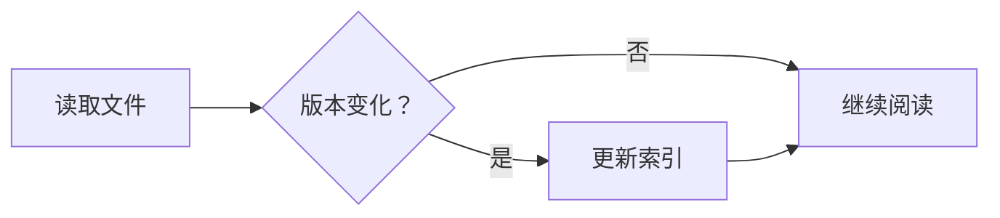
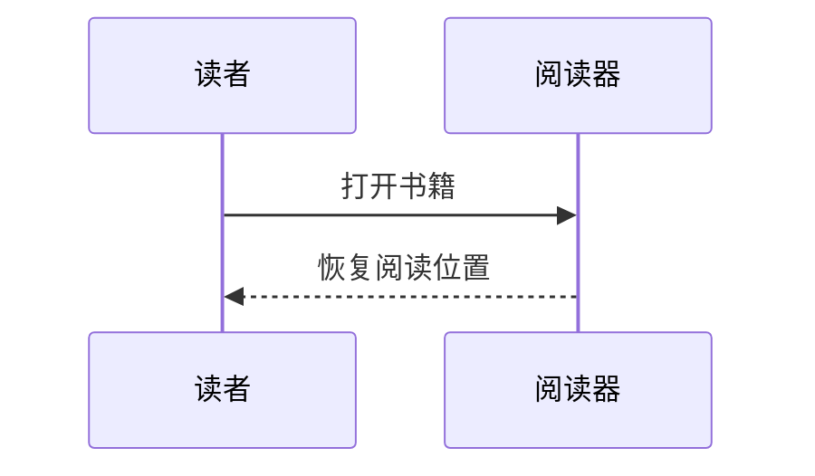

# F5：Mermaid 离线图形阅读

状态：Mermaid 子集解析、布局、原生绘制与源码回退已实现并通过自动验证；真实窗口与用户验收待执行。不新增 SQL schema，不承诺完整 Mermaid 运行时兼容。

## 1. 现状与实施选择

`lib/renderers/epub/epub_renderer_view.dart` 当前把 `EpubBlockType.diagram` 交给代码块组件显示源码；`lib/renderers/markdown/markdown_boundaries.dart` 已有 20,000 字符输入边界。公式已有 `flutter_math_fork` 路径，本任务不改公式。

选定原生方案：Dart tokenizer/parser → typed diagram AST → 有界布局 → Flutter CustomPainter + Semantics。直接接入 Markdown/EPUB 共用 block renderer，不重新开 WebView，不附带 Node、Chromium、在线 Mermaid API 或独立服务器。

取舍：先把常见流程图、基本时序图真正画出来，保留源码入口；复杂 diagram 类型明确回退，不把“语法没报错但少画了节点”作为兼容。完整官方 JS 引擎需另行评估 Linux DOM/runtime、离线包、沙箱和跨端成本，不暗中加入本批依赖。

## 2. 首期支持语法（版本 `mermaid-subset-v1`）

### 2.1 流程图

| 内容 | 支持范围 |
| --- | --- |
| 图声明 | `flowchart TD`、`flowchart TB`、`flowchart LR`；`graph` 同义入口 |
| 标识符 | ASCII 字母或 `_` 开头，后续字母、数字、`_`，1–64 字符；中文放 label |
| 节点 | `A`、`A[文本]`、`A(文本)`、`A{文本}`，分别为默认矩形/矩形/圆角/判断菱形 |
| 中文/符号 label | `A["中文标签"]`，支持双引号内 Unicode，实体转义限定 `#quot;`、`#amp;`、十进制 `#数字;`；解码后仍为纯文本 |
| 边 | `A --> B`、`A --- B`、`A -.-> B`、`A ==> B`；保留方向、虚线/粗线语义 |
| 边 label | `A -->\|通过\| B`；文字按纯文本显示 |
| 链式边 | `A --> B --> C`，每一段独立建边；不可部分成功 |
| 多语句 | 换行或分号分隔，空白与整行 `%%` 注释 |
| 拓扑 | 分支、汇合、孤立节点、自环、回边、重复边均有确定绘制规则 |

同 ID 再声明相同 label/shape 合法；冲突 label/shape 显示“重复定义不一致”并回退，不能悄悄最后写入。引号/括号内的分号、箭头和 `%%` 不作为语句/注释分割。

首期不支持 subgraph、BT/RL、class/style/link/click、frontmatter/init 指令、图标/图片节点、Markdown label、任意 HTML、边动画、新版扩展 shape。出现这些内容时整块回退，不忽略后继续画不完整图。仅允许把 label 中的字面 `<br>`/`<br/>` 转为换行，其他标签按不支持处理，不走 HTML parser。

### 2.2 时序图

| 内容 | 支持范围 |
| --- | --- |
| 声明 | `sequenceDiagram` |
| 参与者 | `participant A`、`participant A as 中文名称`；首次使用未声明 ID 可按出现顺序建立 |
| 消息 | `A->>B: 请求`、`B-->>A: 返回`，实/虚线和箭头正确；支持 self-message |
| 文本 | 冒号后的纯文本，Unicode；字面 `<br>`/`<br/>` 换行 |
| 注释 | 整行 `%%` 与空行 |

首期不支持 actor 图标、activation、loop/alt/opt/par/critical/break、Note、autonumber、create/destroy 和带颜色 box。这里没有把条件/循环语法近似成普通消息，避免误读顺序和条件。

### 2.3 必须通过的最小示例

````markdown



````

这两类图必须有真实节点/连线/箭头和可读文字，不能以代码块、截图占位或普通列表替代。

## 3. 解析、布局与安全

### 3.1 有界 parser

不靠多层贪心正则解析全部语法。tokenizer 跟踪字符串/转义/括号与行列；parser 产出 `FlowchartDiagram/SequenceDiagram` 或 `UnsupportedSyntax/InvalidSyntax/LimitExceeded`，不返回半个图。

预算：输入保持现有 20,000 UTF-16 单位边界；流程图最多 200 节点、400 边；时序图最多 20 参与者、200 消息；单 label 最多 256 UTF-16 单位，按字符边界校验。超过时完整源码仍保留可复制，但不启动昂贵布局。source parser 不读取 URL、文件、网络或任意 Dart/JS。

### 3.2 流程图布局

1. 按出现顺序建立节点/边，生成稳定 ID；AST 不因 viewport 改变身份。
2. 对有向图求强连通分量；分量缩合为 DAG 后分层，跨层长边建立布局用虚拟节点。无向边用于连通/邻接，但不创造原图不存在的箭头。
3. 同层用有界重心排序减少交叉，最多 8 轮；同分按 AST ordinal，保证重复刷新稳定。
4. 字体测量在 Flutter 主 isolate，布局纯数据计算可在 worker isolate；measurements 传入布局，不能在普通 isolate 调 `TextPainter`。
5. SCC 内节点按稳定顺序展开，回边与自环走专用侧向通道；实线/虚线、箭头方向和 label 保留原义。路线尽量避开节点，无法在预算内消除遮挡则回退源码，不画遮住关键 label 的成图。
6. TD/TB 以纵向分层，LR 交换布局主轴；节点文字保持正常方向。节点内文字自然换行，尺寸来自测量，不用硬编码中文等宽估计。

布局输出 `DiagramScene(nodes,edges,labels,bounds,semanticOrder)`，不包含 Widget/数据库对象。renderEpoch+sourceRevision+blockId 校验布局完成结果，旧结果不能覆盖新文件。

### 3.3 时序图布局

参与者按声明/首次出现顺序排布；先根据标题及最宽消息 label 计算列间距，消息按原出现顺序逐行分配高度；self-message 独占高度。lifeline、消息线、箭头与 label 不重叠。横向过宽保留可缩放图，不缩到文字无法阅读还宣称 fit 完成。

### 3.4 安全与失败

不执行 click/link/style/init、HTML/script、远程字体或图标请求。语法错误给出行列及简短原因，原文保持不变。label/错误摘要转义后显示，日志只记错误码和 blockId，不记录整段书籍源码。

## 4. 阅读交互与视觉

- 支持时默认显示图；提供“图形/源码”切换和“展开查看”图标，图标有 tooltip、语义标签及键盘焦点。
- 行内图按内容宽度 fit，保留最小可读字号约 12sp；高度默认不超过 480 logical px，超出显示明确的展开入口，不永久遮盖正文。
- 展开查看复用 app 对话框/面板，支持缩放 50%–300%、复位、平移和 Esc 关闭。默认滚轮仍滚阅读正文，显式缩放控件或 Ctrl+滚轮才缩图，避免滚动陷阱。
- 源码视图可复制完整原文、显示不支持原因；错误不弹常驻黑条。源码中原有换行和字符不能被 parser 的显示修正覆盖。
- 使用现有阅读主题、字体及颜色 token；线/文字满足对比度要求，暗色不把白底 SVG 当替代方案。颜色不是唯一区分方式，虚实线/形状语义保留。
- Semantics 按“图类型 → 节点/参与者 → 边/消息”提供文本顺序；键盘可进入源码和展开图，不能只剩一张无描述 canvas。
- 图块高度变化走现有分页/滚动布局，F1 文件更新与主题/字号变动后重新布局但恢复阅读锚点。图中文字不伪造成原始章节选区，图源码是否进入搜索沿用当前 parser 正文策略，不增加一份重复正文。

## 5. 模块与缓存

拟新增 `lib/renderers/common/diagram/`：`diagram_models.dart`、`mermaid_subset_parser.dart`、`flowchart_layout.dart`、`sequence_layout.dart`、`diagram_painter.dart`、`diagram_view.dart`。解析/布局只依赖 domain-like 值，不依赖 reader UI 或 DAO；共用 renderer 只负责显示 block。

内存缓存 key 为 source hash + parserVersion + layoutVersion + width/fontScale/fontFingerprint/theme；最多 32 个 scene、估算 16 MiB，LRU 淘汰。主题只改变 paint 时可复用 geometry，字体/宽度变化必须重新测量。首期不持久化缓存、不新增包依赖，无法解析时不下载运行时。

性能目标：典型 30 节点图首次布局 ≤ 150 ms、200 节点图 ≤ 1 秒，超 1 秒返回有原因的源码回退；dispose 后取消 worker 或丢弃结果并释放图片/picture。纯计算 worker 超时可终止，UI 测量分批，不以不可取消的大同步函数伪装 timeout。

## 6. 实施与验收

F5-A grammar+AST+错误矩阵；F5-B 两类布局与拓扑不变量；F5-C painter、源码切换、Semantics；F5-D renderer/分页/文件刷新/主题回归与安装。

| ID | 场景 | 必须结果 |
| --- | --- | --- |
| F5-01 | 两个最小示例、TD/LR、中文 label | 真正绘图，字不截断，箭头方向正确 |
| F5-02 | 分支/汇合/回边/自环/重复边/孤立节点 | 节点边数量和语义等于 AST，没有静默丢边 |
| F5-03 | 时序显式/隐式参与者、实虚消息、self-message | 顺序和间距正确，label 不遮线 |
| F5-04 | subgraph/alt/style/HTML/script/URL 等 | 明确整块回退，0 网络/脚本/外部文件读取 |
| F5-05 | 超限、括号错误、重复冲突节点、超时 | 原文可看可复制，阅读器不崩溃 |
| F5-06 | 1024/1440 宽度、暗色、150% 字号 | 图与按钮不溢出，源码入口可达 |
| F5-07 | 快速换文件/改源码/切主题/销毁页面 | 旧布局不覆盖，资源不持续增长 |
| F5-08 | 键盘、屏幕阅读器、展开/缩放/复位 | 图有可理解文本，退出后焦点回原入口 |

拟新增 `test/renderers/common/diagram/mermaid_subset_parser_test.dart`、`flowchart_layout_test.dart`、`sequence_layout_test.dart`、`diagram_view_test.dart`；扩展 `test/renderers/markdown/markdown_rendering_test.dart` 与离屏截图。支持语法 fixture 至少 24 份全部通过；另有至少 12 份不支持/恶意/超限 fixture 全部安全回退。报告支持率时明确该范围，不把 unsupported 计作已渲染。

## 7. 外部依据

语法子集参照 [Mermaid 流程图](https://mermaid.js.org/syntax/flowchart.html) 与 [时序图](https://mermaid.js.org/syntax/sequenceDiagram.html) 官方说明；本项目自行解析与布局，输出不保证与官方 renderer 像素一致。实施时固定 fixture 与 grammar 版本，不随在线文档更新而无迁移扩语法。
